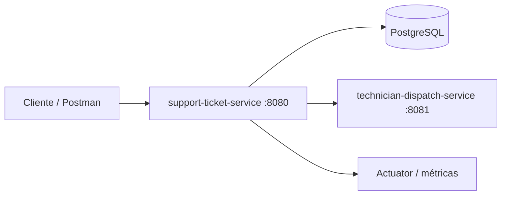
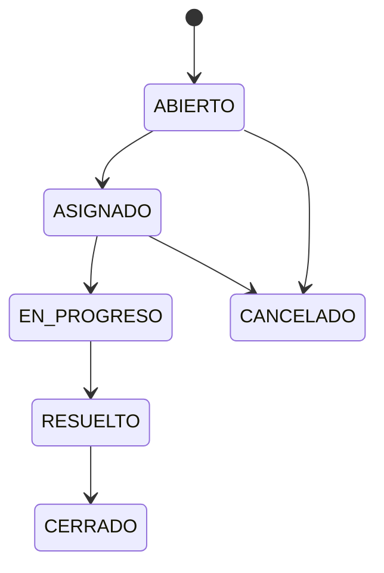

# HelpFlow - Sistema Integral de Soporte TI

Proyecto de prueba de desempeño del Módulo 6. Implementa un sistema de gestión de tickets de soporte basado en arquitectura hexagonal, seguridad JWT, JPA, pruebas, observabilidad y dos microservicios.

## Servicios

- `support-ticket-service`: API principal para usuarios, técnicos, tickets, asignaciones e historial.
- `technician-dispatch-service`: servicio liviano que recomienda un técnico de forma determinista.

## Arquitectura



El servicio central separa adaptadores REST y JPA de los casos de uso. Las operaciones de asignación e historial se ejecutan en una transacción.

El detalle de la arquitectura hexagonal y el ciclo de vida está en [docs/architecture.md](docs/architecture.md).

## Seguridad y roles

`POST /auth/register` registra un usuario activo. `POST /auth/login` devuelve un JWT Bearer. Los endpoints de tickets requieren el encabezado `Authorization: Bearer <token>`.

- `ROLE_USUARIO`: crea y consulta sus propios tickets.
- `ROLE_TECNICO`: gestiona tickets asignados.
- `ROLE_ADMIN`: reasigna y configura reglas operativas.

Para pruebas locales se carga un técnico activo por categoría. Si necesitas habilitar la cuenta administradora `admin@helpflow.com`, define una contraseña propia antes de iniciar el servicio: `BOOTSTRAP_ADMIN_PASSWORD=tu_clave_segura`. Esa clave nunca se guarda en el repositorio.

## Endpoints principales

| Método | Ruta | Descripción |
| --- | --- | --- |
| POST | `/auth/register` | Registro de usuario |
| POST | `/auth/login` | Token JWT |
| POST | `/tickets` | Crear ticket y calcular SLA |
| GET | `/tickets` | Listar tickets del solicitante |
| PATCH | `/tickets/{id}/status` | Cambio de estado con observación |
| POST | `/tickets/{id}/assign` | Asignación automática (admin) |
| POST | `/technician-dispatch` | Sugerencia determinista de técnico |

## SLA

| Prioridad | Límite |
| --- | --- |
| BAJA | 72 horas |
| MEDIA | 24 horas |
| ALTA | 8 horas |
| CRITICA | 2 horas |

Al crear un ticket se calcula el SLA y se consulta el servicio de despacho. Dentro de la misma transacción se asigna un técnico activo con especialidad compatible y con menos de cinco tickets activos, dejando un registro en el historial. Un proceso programado detecta tickets cuyo SLA venció, los marca como escalados y registra el evento.

## Ciclo de vida



## Ejecución prevista

```bash
docker compose up --build
```

Una vez iniciados los servicios:

- API de tickets: `http://localhost:8080`
- API de despacho: `http://localhost:8081`
- PostgreSQL expuesto al host: `localhost:5433`
- Actuator: `http://localhost:8080/actuator/health`
- Swagger UI: `http://localhost:8080/swagger-ui.html`
- Portal de demostración para usuarios: `http://localhost:8080/`

El portal es una interfaz sencilla integrada con la API local: permite registro, inicio de sesión, creación de tickets y consulta de los tickets del usuario autenticado. Fue desarrollado con asistencia de IA e integrado y verificado como parte de la prueba; no sustituye la API ni la documentación técnica en Swagger.

## Pruebas

```bash
mvn test
```

Las pruebas de integración usan H2 y Flyway. La prueba `PostgresContainerIntegrationTest` emplea Testcontainers con PostgreSQL y se ejecuta automáticamente cuando Docker está disponible; en equipos sin Docker se omite de forma segura.

## Demostración y documentación de entrega

- [Guía de verificación, pruebas y evidencias](docs/verification-guide.md)
- [Diagrama de arquitectura hexagonal y ciclo de vida](docs/architecture.md)
- [Colección Postman](docs/postman/HelpFlow.postman_collection.json)
- Swagger/OpenAPI: `http://localhost:8080/swagger-ui.html`

La guía indica exactamente qué capturas tomar para demostrar Docker, pruebas, portal, Swagger y Actuator, evitando incluir contraseñas o tokens en la entrega.

