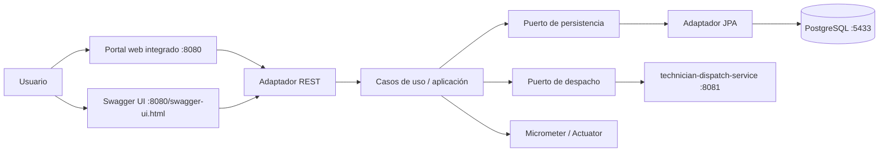
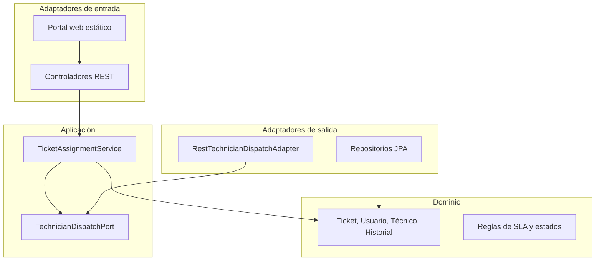
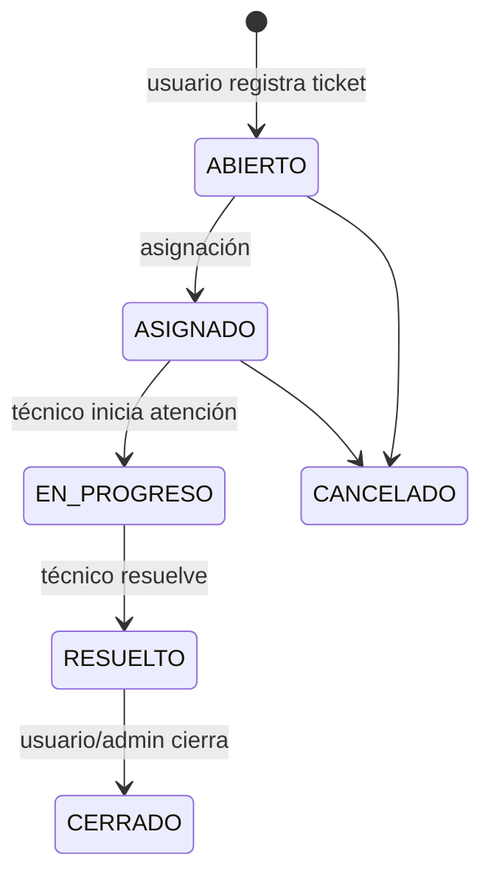

# Arquitectura de HelpFlow

## Vista de contenedores

## Arquitectura hexagonal del servicio central

Las decisiones de asignación, el historial y la transacción se concentran en la capa de aplicación. Los controladores no conocen detalles de persistencia ni de la llamada HTTP al microservicio externo.

## Ciclo de vida del ticket

